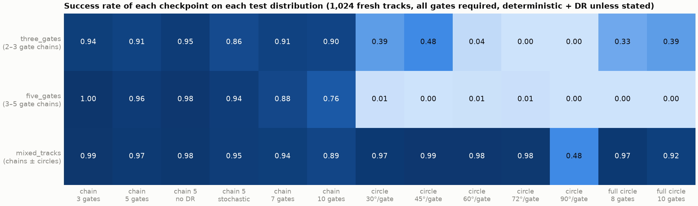

# crazyflow-gate-ppo

A PPO expert that flies a Crazyflie quadrotor through randomised gate tracks in the
[crazyflow](https://github.com/learnsyslab/crazyflow) simulator. Physics, gate logic, policy and the
PPO update run inside one `jax.jit`, so the whole three-stage curriculum trains in **about 5 minutes
on a laptop GPU**. The expert is a data generator for imitation learning (vision-language-action
policies, world models), not an end in itself.


*The recommended expert (`mixed_tracks`) on an 8-gate circle, in real time: overview with the flown
path, chase camera, onboard FPV camera.*

## At a glance

| | |
|---|---|
| **Task** | Pass every gate of a randomised track, in order: random-walk chains and imperfect circles of upright square gates (0.49 m opening, 1.2–2.2 m spacing). |
| **Vehicle** | Crazyflie `cf2x_L250`, first-principles dynamics at 480 Hz with first-order rotor dynamics. |
| **Actions** | 4 motor RPMs at 48 Hz: `rpm = hover_rpm · (1 + 0.35·a)`, `a ∈ [-1, 1]⁴`. |
| **Observation** | 37-D, in the body frame: altitude, gravity direction, velocity, body rates, rotor speeds, previous action, pose of the current and next gate, gates remaining. |
| **Learner** | PureJaxRL-style PPO; 2×256 tanh actor and critic; truncation bootstrapping; running observation normalisation; domain randomisation of mass, inertia and motor gain; yaw-range curriculum. |
| **Gate events** | Geometric plane-crossing tests in JAX, no MJX contact queries; worlds auto-reset in the same step. |
| **Speed** | ≈ 5 × 10⁵ env steps/s with 1,024 parallel worlds on an RTX 2080 (8 GB). |

## Results



Success rate on 1,024 fresh tracks per cell (all gates required, deterministic policy, domain
randomisation on unless stated; seed 0, crazyflow 0.3.2). The `mixed_tracks` expert reaches
**97 % on 5-gate chains**, **97–99 % on circles up to 72° per gate** and **89 % on 10-gate chains**,
twice the training length. Full tables: [`results/2026-09-08_seed0.md`](results/2026-09-08_seed0.md).

| Stage | Training tracks | Steps | Wall time |
|---|---|---|---|
| `three_gates` | 2–3 gate chains | 30 M | 1.2 min |
| `five_gates` | 3–5 gate chains, warm start | 50 M | 2.1 min |
| `mixed_tracks` | chains with perturbed gate normals + imperfect circles, warm start | 30 M | 1.4 min |


*The `five_gates` expert on a 5-gate chain: chase camera and onboard FPV camera.*

## Lesson: track samplers leak shortcuts


*Same 8-gate circle. Left: the chain-only `five_gates` expert leaves gate 1 along its normal and
clips the frame of gate 2. Right: the `mixed_tracks` expert.*

The chain sampler makes every gate normal point along the path from the previous gate, so "fly along
the gate normal" and "fly to the gate" are the same thing in training, and the policy learned the
first. Circles break that coincidence: the chain-only expert scores ≈ 1 % on them, even at turns
inside its training range, and rotating the gate normals of ordinary chains reproduces the collapse
gradually. Fine-tuning on both families (`experiment=mixed_tracks`, 1.4 min) fixes it and also
improves long chains. Check every new track family for such regularities before trusting the expert.

## Quickstart

Requires Linux x86-64 and CUDA 12 for the GPU extra; `run.device=cpu` works anywhere.

```bash
uv sync && uv run pytest     # Python 3.12, crazyflow[gpu]==0.3.2; CPU test suite (~30 s)

# three-stage curriculum, each stage warm-started from the previous checkpoint
uv run gate-ppo-train experiment=three_gates
uv run gate-ppo-train experiment=five_gates   run.init_from=outputs/three_gates/<run>/checkpoint.pkl
uv run gate-ppo-train experiment=mixed_tracks run.init_from=outputs/five_gates/<run>/checkpoint.pkl

# evaluate on 1,024 fresh tracks, save trajectories, then render one flight
uv run gate-ppo-eval --ckpt outputs/mixed_tracks/<run>/checkpoint.pkl --n-gates 5 --save-traj traj.npz
uv run gate-ppo-eval --ckpt ... --n-gates 5 --track-type circle --gates-per-turn 8   # 45° per gate
uv run gate-ppo-render --traj traj.npz --camera fpv --out flight.mp4   # track | fpv | overview | free
```

Every config key is a Hydra override (`env.n_envs=256 run.device=cpu`, `run.seed=0,1,2 -m`). Runs
write to `outputs/<run.name>/<timestamp>/` (checkpoint, metrics, resolved config); the checkpoints
and videos of the reported runs are committed there. `run.wandb=true` logs to Weights & Biases
(`uv sync --extra wandb`). `gate-ppo-eval --stochastic` samples actions, for diverse demonstrations.

## Layout

```
configs/          Hydra config + experiment overrides (single_gate, three_gates, five_gates, mixed_tracks)
src/gate_ppo/     config · geometry (gate test) · track (samplers) · env (GateRaceEnv) · networks ·
                  ppo (rollout + GAE + update in one jit) · train · evaluate · render
tests/            CPU tests: geometry, env invariants, one PPO iteration
results/          evaluation JSONs, run configs, figures; scripts/make_report_figures.py rebuilds them
outputs/          checkpoints, metrics and videos of the reported runs
docs/media/       README animations (made from the videos in outputs/)
```

## Gotchas

- **Pre-spin the rotors exactly at hover at reset.** crazyflow's rotors follow first-order dynamics
  (τ ≈ 0.14 s); a ±5 % per-motor jitter is an undamped torque impulse that tumbles the drone. Get
  initial diversity from `env.start_ang_vel_max` / `start_tilt_max` / `start_vel_max` instead.
- **Cap the "gates remaining" feature at the training horizon** (`env.obs_remaining_cap`). Uncapped,
  longer chains are out of distribution: 39 % → 77 % success on 10-gate chains with the same
  checkpoint.
- **crazyflow 0.3.2 does not clip rotor speeds**; the action mapping bounds RPM to `[0.65, 1.35] · hover`.
- Only `mass` and `J` have a world axis for per-world randomisation; `rpm2thrust` and
  `rotor_dyn_coef` do not, hence the motor-gain factor in the action mapping.
- `sim.contacts()` costs ~5× on CPU; gate events are geometric on purpose.
- Import `gate_ppo` (or crazyflow) before scipy: crazyflow needs `SCIPY_ARRAY_API=1`.
