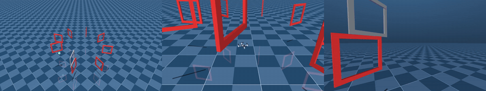
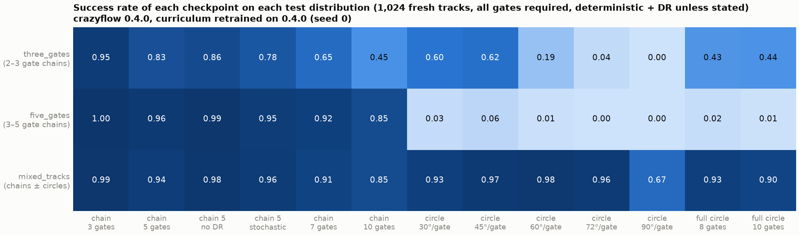
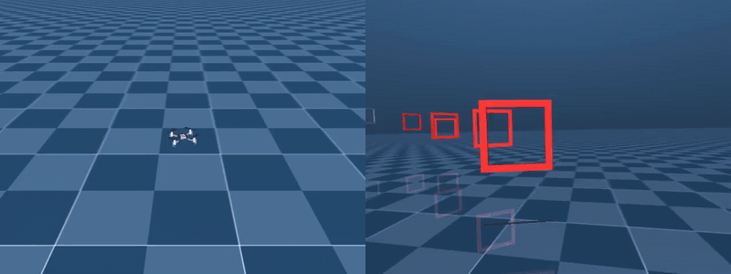
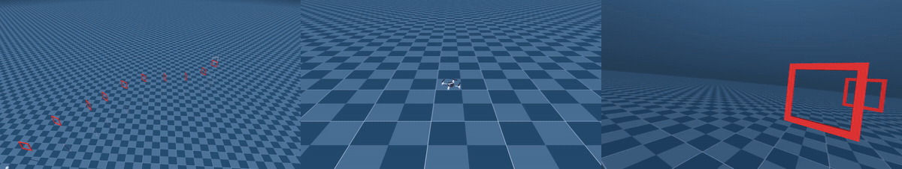
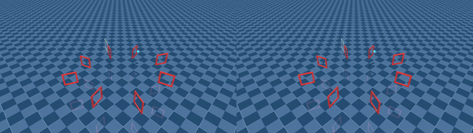

# crazyflow-gate-ppo

A PPO expert that flies a Crazyflie quadrotor through randomised gate tracks in the
[crazyflow](https://github.com/learnsyslab/crazyflow) simulator. Physics, gate logic, policy and the
PPO update run inside one `jax.jit`, so the whole three-stage curriculum trains in **about 5 minutes
on a laptop GPU**. The expert is a data generator for imitation learning (vision-language-action
policies, world models), not an end in itself.



*The recommended expert (`mixed_tracks`) on an 8-gate circle, in real time: overview with the flown
path, chase camera, onboard FPV camera.*

## At a glance

| | |
|---|---|
| **Task** | Pass every gate of a randomised track, in order: random-walk chains and imperfect circles of upright square gates (0.49 m opening, 1.2–2.2 m spacing). |
| **Vehicle** | Crazyflie `cf2x_L250` in crazyflow 0.4.0, first-principles dynamics at 480 Hz with first-order rotor dynamics. |
| **Actions** | 4 motor RPMs at 48 Hz: `rpm = hover_rpm · (1 + 0.35·a)`, `a ∈ [-1, 1]⁴`, clipped to the motor limits (≤ 0.12 N per motor). |
| **Observation** | 37-D, in the body frame: altitude, gravity direction, velocity, body rates, rotor speeds, previous action, pose of the current and next gate, gates remaining. |
| **Learner** | PureJaxRL-style PPO; 2×256 tanh actor and critic; truncation bootstrapping; running observation normalisation; domain randomisation of mass, inertia and motor gain; yaw-range curriculum. |
| **Gate events** | Geometric plane-crossing tests in JAX, no MJX contact queries; worlds auto-reset in the same step. |
| **Speed** | ≈ 4.5 × 10⁵ env steps/s with 1,024 parallel worlds on an RTX 2080 (8 GB). |

## Results



Success rate on 1,024 fresh tracks per cell (all gates required, deterministic policy, domain
randomisation on unless stated; seed 0, crazyflow 0.4.0). The "chain" columns of the
`mixed_tracks` row use that expert's own training mix of chains and circles. On plain chains the
`mixed_tracks` expert reaches **94 % with 5 gates** and **83 % with 10 gates** (twice the training
length), and **93–98 % on circles up to 72° per gate**. On crazyflow 0.3.2 the same curriculum
scored 1–7 points higher on these cells; 0.4.0 caps the motor thrust, and the expert flies ≈ 15 %
slower ([`results/2026-10-29_crazyflow040.md`](results/2026-10-29_crazyflow040.md); 0.3.2 tables:
[`results/2026-09-08_seed0.md`](results/2026-09-08_seed0.md)).

| Stage | Training tracks | Steps | Wall time |
|---|---|---|---|
| `three_gates` | 2–3 gate chains | 30 M | 1.3 min |
| `five_gates` | 3–5 gate chains, warm start | 50 M | 2.1 min |
| `mixed_tracks` | chains with perturbed gate normals + imperfect circles, warm start | 30 M | 1.5 min |



*The `mixed_tracks` expert on a 5-gate chain: chase camera and onboard FPV camera.*



*The same expert on a 10-gate chain, twice its training length: overview, chase camera, onboard FPV
camera.*

## Lesson: track samplers leak shortcuts



*Same 8-gate circle. Left: the chain-only `five_gates` expert turns towards gate 2 but reaches it
at an angle to its normal and hits the frame. Right: the `mixed_tracks` expert.*

The chain sampler makes every gate normal point along the path from the previous gate, so "fly along
the gate normal" and "fly to the gate" are the same thing in training, and the policy never learns
to line up with a gate whose normal points elsewhere. Circles break that coincidence: the
chain-only expert scores ≤ 6 % on them, even at turns inside its training range, and rotating the
gate normals of ordinary chains reproduces the collapse gradually (97 % → 58 % at ±0.26 rad).
Fine-tuning on both families (`experiment=mixed_tracks`, 1.5 min) fixes it. Check every new track
family for such regularities before trusting the expert.

## Quickstart

Requires Linux x86-64 and CUDA 12 for the GPU extra; `run.device=cpu` works anywhere.

```bash
uv sync && uv run pytest     # Python 3.12, crazyflow[gpu]==0.4.0; CPU test suite (~35 s)

# three-stage curriculum, each stage warm-started from the previous checkpoint
uv run gate-ppo-train experiment=three_gates
uv run gate-ppo-train experiment=five_gates   run.init_from=outputs/three_gates/<run>/checkpoint.pkl
uv run gate-ppo-train experiment=mixed_tracks run.init_from=outputs/five_gates/<run>/checkpoint.pkl

# evaluate on 1,024 fresh tracks, save trajectories, then render one flight
uv run gate-ppo-eval --ckpt outputs/mixed_tracks/<run>/checkpoint.pkl --n-gates 5 --save-traj traj.npz
uv run gate-ppo-eval --ckpt ... --n-gates 5 --track-type circle --gates-per-turn 8   # 45° per gate
uv run gate-ppo-render --traj traj.npz --camera fpv --out flight.mp4   # track | fpv | overview | free
```

Every config key is a Hydra override (`env.n_envs=256 run.device=cpu`, `run.seed=0,1,2 -m`). Runs
write to `outputs/<run.name>/<timestamp>/` (checkpoint, metrics, resolved config); the checkpoints
and videos of the reported runs are committed there. `run.wandb=true` logs to Weights & Biases
(`uv sync --extra wandb`). `gate-ppo-eval --stochastic` samples actions, for diverse demonstrations.

## Layout

```
configs/          Hydra config + experiment overrides (single_gate, three_gates, five_gates, mixed_tracks)
src/gate_ppo/     config · geometry (gate test) · track (samplers) · env (GateRaceEnv) · networks ·
                  ppo (rollout + GAE + update in one jit) · train · evaluate · render
tests/            CPU tests: geometry, env invariants, one PPO iteration
results/          evaluation notes, JSONs and figures; scripts/eval_matrix.py and
                  scripts/make_report_figures.py rebuild them
outputs/          checkpoints, metrics and videos of the reported runs
docs/media/       README animations (made from the videos in outputs/)
```

## Gotchas

- **Pre-spin the rotors exactly at hover at reset.** crazyflow's rotors follow first-order dynamics
  (τ ≈ 0.14 s); a ±5 % per-motor jitter is an undamped torque impulse that tumbles the drone. Get
  initial diversity from `env.start_ang_vel_max` / `start_tilt_max` / `start_vel_max` instead.
- **Cap the "gates remaining" feature at the training horizon** (`env.obs_remaining_cap`). Uncapped,
  longer chains are out of distribution: 39 % → 77 % success on 10-gate chains with the same
  checkpoint (crazyflow 0.3.2).
- **crazyflow 0.4.0 clips the rotor command to the motor limits** (0.0128–0.12 N per motor), i.e.
  `[0.44, 1.21] · hover` for `cf2x_L250`. The top of the action range (`1.35 · hover`) is cut, and
  the thrust-to-weight ratio is at most 1.49. 0.3.2 had no clip. `info["rpm_cmd"]` is the clipped
  command.
- **0.4.0 changed the `cf2x_L250` parameters**: mass 31.9 → 32.8 g, slightly larger drag. Hover
  is 19,217 RPM (18,968 RPM in 0.3.2). Checkpoints trained on 0.3.2 collapse on 0.4.0, almost
  entirely because of the clip (`mixed_tracks` on its 5-gate mix: 97 % → 22 %), so retrain them
  ([`results/2026-10-29_crazyflow040.md`](results/2026-10-29_crazyflow040.md)).
- In 0.4.0 the dynamics parameters are shared across worlds by default. Every parameter accepts
  leading `(world, drone)` axes, and thrust curves and rotor dynamics also accept a motor axis.
  `GateRaceEnv.init_state` gives `mass`, `J` and `J_inv` a world axis; the motor-gain factor of
  the action mapping stays, so that 0.3.2 and 0.4.0 runs see the same randomisation.
- Ground effect and downwash are not in the 0.4.0 wheel, so they are off.
- `sim.contacts()` costs ~5× on CPU; gate events are geometric on purpose.
- Import `gate_ppo` (or crazyflow) before scipy: crazyflow needs `SCIPY_ARRAY_API=1`.
